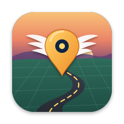

# WingerMaps

**Fresh, routable maps for the navigation of your Honda Gold Wing GL1800 — built on your Mac from OpenStreetMap.**

[Website](https://www.snelgraveren.nl/Apps/wingermaps/) &nbsp;&bull;&nbsp; [Report a problem](https://github.com/temmink/WingerMaps/issues/new/choose) &nbsp;&bull;&nbsp; [Privacy policy](https://temmink.github.io/WingerMaps/privacy-policy.html)

**English** · [Nederlands](#nederlands) · [Deutsch](#deutsch) · [Français](#français)

---

## What is WingerMaps?

WingerMaps is a native macOS app that builds Garmin-compatible maps (`gmapsupp.img`) from OpenStreetMap for the factory navigation of the Honda Gold Wing GL1800, and writes them safely to the CF card — after backing up your original map.

- Pick whole countries with a right-click on the map, or draw a rectangle or free-form area
- Routable: the navigation calculates routes itself, with one-way streets and turn restrictions, across borders too
- Address search by town, street and house number
- Made for motorcycles: only roads you may ride, a calm map view, compact files — you choose the map content
- Backs up the GARMIN folder on your card first, checks space and firmware, and ejects the card properly

The source code is not included in this repository. This repository is for **support**: questions, bug reports and feature requests.

## Requirements

- A Mac with macOS 14 Sonoma or later (Apple silicon or Intel)
- Honda Gold Wing GL1800 with navigation, European version, navigation software 2.60 or later (tested with 2.90)
- A CF card and card reader. Maps can be up to just under 4 GB per file (FAT32); tested: a 3.2 GB map on an 8 GB card
- An internet connection to download OpenStreetMap data

## Troubleshooting

**The navigation doesn't show my new map.**
Check that the card holds `GARMIN/gmapsupp.img` and that the navigation software is 2.60 or later — WingerMaps shows the version of the update file on the card. Swap cards only with the ignition off. The first start with a new map can take several minutes while the navigation indexes it.

**Can I go back to my original map?**
Yes. Before writing, WingerMaps backs up the GARMIN folder on your card. Under *Backups* you can put it back on the same or another card.

**How big can a map be?**
One file must stay under 4 GB (FAT32). Under *Map Content* you can leave out paths, small areas or points of interest to make maps smaller.

**Why is the first map slow to build?**
The first time, WingerMaps downloads and reads the country data. It keeps the result, so the next map with the same country is much faster — even after changing the map content settings.

**What does the full version add?**
The free version builds maps of small areas (up to 40 km per side). A one-time in-app purchase unlocks maps of whole countries, with no subscription. Purchases can be restored in Settings.

## Support

- **Bugs and feature requests:** [open an issue](https://github.com/temmink/WingerMaps/issues/new/choose). Please include your macOS version, the navigation software version and what you see on the screen.
- **Purchase questions:** info@snelgraveren.nl

## Privacy

WingerMaps collects no personal data. No account, no tracking, no analytics. See the [privacy policy](https://temmink.github.io/WingerMaps/privacy-policy.html).

## License

WingerMaps is proprietary software © 2026 Martin Temmink. Map data © [OpenStreetMap contributors](https://www.openstreetmap.org/copyright), available under the ODbL. WingerMaps is not affiliated with Honda or Garmin.

---

## Nederlands

WingerMaps is een Mac-app die van OpenStreetMap routeerbare kaarten maakt voor de navigatie van de Honda Gold Wing GL1800 en ze veilig op de CF-kaart zet, na eerst een backup van je originele kaart. Vereist macOS 14 of nieuwer en navigatiesoftware 2.60 of hoger (getest met 2.90).

Problemen of wensen? [Meld ze hier](https://github.com/temmink/WingerMaps/issues/new/choose), in het Nederlands mag ook. Vragen over een aankoop: info@snelgraveren.nl. Meer informatie en veelgestelde vragen op de [website](https://www.snelgraveren.nl/Apps/wingermaps/?lang=nl).

## Deutsch

WingerMaps ist eine Mac-App, die aus OpenStreetMap routingfähige Karten für das Navi der Honda Gold Wing GL1800 erstellt und sie sicher auf die CF-Karte kopiert – nachdem deine Originalkarte gesichert wurde. Erfordert macOS 14 oder neuer und Navi-Software 2.60 oder neuer (getestet mit 2.90).

Probleme oder Wünsche? [Hier melden](https://github.com/temmink/WingerMaps/issues/new/choose), gern auch auf Deutsch. Fragen zum Kauf: info@snelgraveren.nl. Mehr Infos und häufige Fragen auf der [Website](https://www.snelgraveren.nl/Apps/wingermaps/?lang=de).

## Français

WingerMaps est une app Mac qui crée, à partir d’OpenStreetMap, des cartes routables pour la navigation de la Honda Gold Wing GL1800 et les copie en toute sécurité sur la carte CF, après avoir sauvegardé votre carte d’origine. Nécessite macOS 14 ou ultérieur et le logiciel de navigation 2.60 ou ultérieur (testé avec la 2.90).

Un problème ou une suggestion ? [Signalez-le ici](https://github.com/temmink/WingerMaps/issues/new/choose), en français si vous le souhaitez. Questions d’achat : info@snelgraveren.nl. Plus d’informations et FAQ sur le [site web](https://www.snelgraveren.nl/Apps/wingermaps/?lang=fr).
